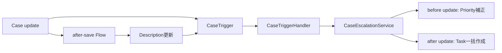

# Salesforce Apex Learning Portfolio

Salesforceの運用保守経験を土台に、Apexを自分で設計・実装・テスト・改善し、その判断理由まで説明できることを示す学習ポートフォリオです。

単にコードを動かすだけではなく、次の観点を各チェックポイントで確認しています。

- Salesforceのガバナ制限を考慮した一括処理
- CRUD、FLS、レコード共有を考慮したセキュリティ設計
- 正常系・異常系・境界値を具体的に証明するApexテスト
- Trigger、Handler、Service、Flowの責務分離
- 入力不変性、例外、部分成功、ロールバック範囲の明文化
- スクラッチ組織へのデプロイ、関連テスト、静的解析の証拠保存
- 設計案と不採用案の比較、および判断理由の記録

## 現在の進捗

| CP | テーマ | 状態 | 主な成果 |
| --- | --- | --- | --- |
| CP0 | 開発環境 | 完了 | Salesforce DX、Git、スクラッチ組織、証拠保存の基盤 |
| CP1 | CollectionUtils | 完了 | Caseの抽出・Account別グループ化、null・空・順序・200件対応 |
| CP2 | SOQL Recipes | 完了 | USER_MODE検索、決定的順序、共有・CRUD・FLSテスト、Query Plan |
| CP3 | DML Recipes | 完了 | USER_MODE一括insert、全件成功・部分成功、入力別結果、入力不変性 |
| CP4 | Trigger Recipes | 完了 | 共通TriggerHandler、Caseエスカレーション、Flow再入、Task一括作成 |
| CP5 | Apexテスト | 完了 | CaseIndexServiceのテストを15件へ再設計し、独立性と具体的Assertを強化 |
| CP6 | Security Recipes | 進行中 | Accountの安全な参照・更新、CRUD・FLS・共有の正負テストを設計・実装中 |
| CP7〜CP9 | Invocable／非同期／REST・Callout | 未着手 | CP6完了後に順番に実施 |

進捗は固定の全体期限ではなく、各CPの完了条件に基づいて管理しています。

## 代表的な実装

### CaseIndexService

メモリ上のCaseを検証し、未完了かつAccountに関連付くCaseだけを`Map<Id, List<Case>>`へ分類します。

- null入力、空List、List内nullを安全に処理
- AccountIdなし、Statusなし、Closedを除外
- 同一Account内では入力順を維持
- 入力ListとCaseを変更しない
- SOQL・DMLを実行せず200件を処理

CP5では、既存7テストを目的別の15テストへ再設計しました。

### CaseSelector

指定されたAccount IdとStatusに一致するCaseを1回のSOQLで取得します。

- `WITH USER_MODE`によるCRUD・FLS・共有の適用
- null・空・Set内null／空白を処理
- 呼出元のSetを変更しない
- `AccountId ASC, CreatedDate ASC, Id ASC`による決定的順序
- Minimum Accessユーザーと分割したPermission Setによる権限テスト
- Account／Caseの非公開共有設定によるレコード可視性テスト
- 2,000件規模のリソース使用量とQuery Planを記録

### AccountBulkCreateService

外部入力として受け取ったAccount候補をUSER_MODEで一括登録し、入力ごとの結果を返します。

- `ALL_OR_NONE`と`PARTIAL_SUCCESS`をenumで明示
- List内null、既存Id、必須項目不足を区別
- `Database.insert`をループ外で最大1回実行
- `SaveResult`と元入力indexを対応付け
- 全`Database.Error`を独自結果へ変換
- 元List・元Accountを変更しない
- 200件一括処理をテスト

### Caseエスカレーション自動化

Caseが「Escalated以外からEscalatedへ」変更された場合に、PriorityをHighへ補正し、確認Taskを作成します。



- 1オブジェクト1Trigger
- 共通`TriggerHandler`がcontext、bypass、loop countを管理
- before updateで直接補正し、Caseの追加DMLを回避
- after updateでTaskを一括insert
- AccountId不足は`addError()`でレコード単位に拒否
- Task DML失敗時はCase更新を含むトランザクション全体をロールバック
- Flow再入時はStatus遷移条件によりTaskの重複作成を防止
- 200件一括更新とFlowを含む結合テストを実施

## 設計上の方針

### バルク対応

- SOQLとDMLをループ内で実行しない
- Triggerの代表的な一括単位である200件を境界として確認
- List、Set、Mapを使って入力と結果の対応を維持
- 処理の分割、非同期化、再試行は必要に応じて呼出元の責務として分離

### セキュリティ

- クラスには共有方針を明示
- CRUD・FLSを適用する処理では`WITH USER_MODE`または明示的なUSER_MODE DMLを使用
- 権限不足を例外にするfail-fastと、`stripInaccessible()`による項目除去を要件に応じて使い分け
- `Minimum Access - Salesforce`ユーザーと最小単位のPermission Setで正負テストを分離
- `View All`／`Modify All`に依存せず、非公開共有と所有者の違いをテスト

### テスト

- 原則`SeeAllData=false`
- テストデータはテスト内で作成し、組織データへ依存しない
- Arrange／Act／Assertを意識して、期待値・実測値・失敗理由が分かるAssertメッセージを記載
- null、空、対象外、複数件、200件、権限不足、部分成功、ロールバックを目的別に確認
- `Test.startTest()`／`Test.stopTest()`の範囲を検証対象へ限定
- DML文数、DML行数、SOQL回数、取得行数を必要なテストで実測

## 検証実績

完了済みCPでは、スクラッチ組織への実デプロイ、対象テスト、関連テスト、静的解析を確認しています。

| 対象 | 主な確認結果 |
| --- | --- |
| CP2 CaseSelector | 対象13テスト、関連20テスト、リソース使用量、Query Plan |
| CP3 DML Recipes | 対象20テスト、関連40テスト、実デプロイ、静的解析 |
| CP4 Trigger Recipes | 関連46テスト、Flowを含むデプロイ、静的解析 |
| CP5 Apexテスト | 対象15テスト、関連61テスト、組織全体カバレッジ88%、静的解析 |

公開版では、テスト件数、カバレッジ、静的解析結果を[匿名化した検証サマリー](evidence/README.md)として掲載しています。Deployment ID、Test Run ID、ユーザー名、組織ID、ローカル絶対パス、未加工ログは公開対象に含めていません。

## プロジェクト構成

```text
.
├── config/                 # スクラッチ組織定義
├── design/                 # CP別の詳細設計書
├── evidence/               # 匿名化した検証結果のサマリー
├── force-app/              # Apex、Trigger、Flow、Permission Set等
└── sfdx-project.json       # Salesforce DXプロジェクト設定
```

主な設計書：

- [CP4 Trigger Recipes詳細設計](design/CP4_TRIGGER_RECIPES_DESIGN.md)
- [CP5 Apexテスト詳細設計](design/CP5_APEX_TESTS_DESIGN.md)
- [CP6 Security Recipes詳細設計（進行中）](design/CP6_SECURITY_RECIPES_DESIGN.md)

## 使用技術・環境

- Salesforce DX Project
- Apex／SOQL／DML
- Apex Trigger／Record-Triggered Flow
- Permission Set／OWD／Role／System.runAs
- Salesforce CLI
- Salesforce Code Analyzer
- Git／GitHub／Pull Request
- ソースAPIバージョン：67.0
- スクラッチ組織：Developer Edition

## 再現手順

### 前提

- Salesforce CLIが利用できること
- Dev Hubへ認証済みであること
- スクラッチ組織を作成できる権限があること

ローカル固有のaliasはGit管理しません。次の`<dev-hub-alias>`と`<scratch-org-alias>`は、自分の環境に合わせて置き換えてください。

### 1. スクラッチ組織の作成

```powershell
sf org create scratch `
  --definition-file config/project-scratch-def.json `
  --alias <scratch-org-alias> `
  --duration-days 7 `
  --target-dev-hub <dev-hub-alias> `
  --wait 10
```

スクラッチ組織定義では、Account、Case、Opportunityの共有モデルをPrivateに設定しています。

### 2. ソースのデプロイとテスト

```powershell
sf project deploy start `
  --source-dir force-app `
  --target-org <scratch-org-alias> `
  --test-level RunLocalTests `
  --wait 30
```

### 3. 関連全テストの再実行

```powershell
sf apex run test `
  --test-level RunLocalTests `
  --target-org <scratch-org-alias> `
  --wait 30 `
  --code-coverage `
  --result-format human
```

組織の季節リリースによるAPIバージョンと、各メタデータのAPIバージョンは分けて確認します。実際の検証条件は各証拠ファイルに記録しています。

## 学習・開発の進め方

各CPは次のGateで進めています。

1. 公式コードと仕様を読み、本人が処理と制約を説明する
2. 類似要件について、責務、API、例外、セキュリティ、テストを設計する
3. 設計に基づいて本人が実装する
4. レビュー指摘を本人が修正する
5. スクラッチ組織でデプロイ・テスト・実測する
6. 静的解析、証拠整理、振り返りを行う
7. feature branchからPull Requestを作成し、review後にmainへmergeする

Apex Recipesは参照教材として使用し、このリポジトリの学習コードは公式コードをそのままコピーせず、要件を再設計して実装しています。

## セキュリティと公開範囲

次の情報はリポジトリへ保存しません。

- アクセストークン、refresh token、client secret、秘密鍵
- 認証URL
- 実ユーザー名やメールアドレス
- 不要な組織ID、ユーザーID、ローカル絶対パス

証拠として必要なDeployment IDやTest Run IDは残し、それ以外の識別情報はサニタイズしています。
